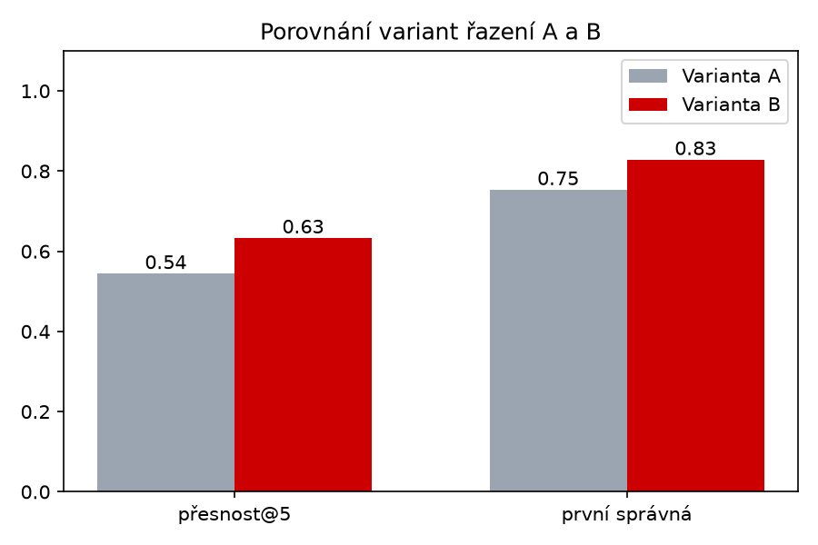

# Mini vyhledávač firem

Malý výukový prototyp vyhledávání a řazení firem v katalogu. Vznikl jako ukázkový projekt k pozici **Ranking Product Manager (Firmy.cz)**. Cílem není hotový vyhledávač, ale ukázat způsob práce: najít problém v kvalitě výsledků, navrhnout úpravu, změřit její dopad a umět výsledky vysvětlit.

Projekt jsem vytvořil v Pythonu s pomocí AI asistenta.

## Co projekt umí

Program má menu se třemi režimy, mezi kterými se dá přepínat (prázdný řádek = návrat do menu, Enter v menu = konec). Ve **vyzkoušení vyhledávání** napíšete dotaz (např. `instalatér v Brně`) a program vypíše pět nejlepších firem podle dvou variant řazení. U každého výsledku ukáže i rozpis skóre, tedy proč je firma na daném místě. Ve **vyhodnocení A/B** program projde sadu testovacích dotazů se známými správnými odpověďmi, spočítá metriky pro obě varianty a uloží graf jejich porovnání. **Přehled dat** vypíše, jaké obory jsou v katalogu a ve kterých městech.

## Spuštění

Na Windows stačí poprvé dvakrát kliknout na `spustit.bat`, který doinstaluje potřebné knihovny a spustí program. Potom už jde spouštět i přímo `hledani.py`. Ručně:

```
pip install -r requirements.txt
python hledani.py
```

## Soubory

| Soubor | Obsah |
|---|---|
| `hledani.py` | celý program |
| `spustit.bat` | spuštění dvojklikem na Windows |
| `firmy.csv` | 218 vymyšlených firem (id, název, obor, město, popis, hodnocení, počet recenzí) |
| `dotazy.csv` | testovací dotazy a id firem, které jsou pro ně správnou odpovědí |
| `ab_vysledky.png` | graf porovnání variant, vytvoří ho vyhodnocení |
| `bez_vysledku.csv` | dotazy, které nic nenašly; vzniká při vyzkoušení, do repozitáře se nenahrává |

## Jak řazení funguje

**Varianta A** řadí jen podle shody textu. Za každé slovo dotazu, které se najde v údaji firmy, firma získá body podle váhy údaje: obor 3, název 2, město 2, popis 1.

**Varianta B** k tomu přičte bonus za kvalitu: 0,4 × hodnocení a 0,4 × log₁₀(1 + počet recenzí). Logaritmus zajistí, že rozdíl mezi 10 a 100 recenzemi je důležitý, ale mezi 1 000 a 1 100 už skoro ne.

Před porovnáním se text upravuje:

1. **Malá písmena a odstranění diakritiky**, takže `instalater` najde `instalatér`.
2. **Zjednodušení českých tvarů slov** uříznutím běžných koncovek (`Brně`, `Brna`, `Brnem` → `brn`) a malý slovník výjimek pro tvary, které se mění i uvnitř slova (`Praze` → `praha`, `Plzni` → `plzen`).
3. **Synonyma**: malý slovník slov, která znamenají totéž co obor v katalogu (`autodílna` → `autoservis`, `kadeřník` → `kadeřnictví`).
4. **Vynechání slov, která nic nehledají** (krátká slova jako `v`, `z` a stop slova jako `nejlepší`, `levný`).
5. **Pravidlo „všechna slova“**: firma se zobrazí jen tehdy, když se v ní najde každé podstatné slovo dotazu. Dřív stačila shoda jediného slova, a dotaz `instalater Brno` tak vracel všechny brněnské firmy (posilovnu, kadeřnictví, pneuservis).

Když dotaz přesně nic nenajde (např. `autoservis Brno`, ale v Brně žádný autoservis v datech není), program to řekne a zkusí hledat znovu bez města, takže nabídne výsledky z jiných měst místo prázdné stránky. Vyhodnocení A/B tuto záložní nabídku nepoužívá, měří jen přesné výsledky.

Dotazy, které nic nenajdou, se ukládají do `bez_vysledku.csv` a vyhodnocení vypíše jejich přehled. Dotazy bez výsledku jsou běžná metrika kvality vyhledávání a dobrý zdroj nápadů, co zlepšit.

## Výsledky

Metriky: **přesnost@5** = jaký podíl z prvních pěti výsledků je správný; **první správná** (MRR) = 1 / pořadí první správné firmy (1 = hned první, 0 = v top 5 žádná).

| | Varianta A přesnost@5 | Varianta A první správná | Varianta B přesnost@5 | Varianta B první správná |
|---|---|---|---|---|
| Původní verze | 0,51 | 0,74 | 0,60 | 0,80 |
| Po úpravách | 0,54 | 0,75 | 0,63 | 0,83 |



Úpravy zlepšily obě varianty, ale jen mírně (přesnost@5 o 0,03, první správná o 0,01 až 0,03). Je to hlavně tím, že testovací sada obsahuje skoro jen „učesané“ dotazy s diakritikou a v základním tvaru, kde původní verze fungovala dobře; největší přínos úprav (dotazy bez diakritiky, tvary jako „v Brně“, odfiltrování nesouvisejících firem) se v ní projeví jen málo. Dalším krokem by proto bylo rozšířit testovací sadu o dotazy, jak je lidé skutečně píší, třeba z přehledu dotazů bez výsledku.

Varianta B je lepší než A ve všech metrikách. Nejvýraznější je to u dotazu „restaurace Boskovice“, kde bonus za hodnocení posunul správnou firmu z 5. na 1. místo. Nejslabší dotazy jsou „účetní Brno“ (přesnost 0,2) a „oprava kotle Brno“, který vrátí jen 2 firmy, protože „kotel“ není obor a vyskytuje se jen v popisech.

## Zjištění z dat

**Shoda v názvu firmy má velkou váhu.** Firma, která má hledané slovo v názvu (např. „Autoservis Čermák“, 4,5 ★, 25 recenzí), předběhne i výrazně lépe hodnocenou firmu bez něj (5,0 ★, 264 recenzí), protože bonus za kvalitu je menší než bonus za název. V reálném katalogu by to motivovalo firmy dávat si klíčová slova do názvu. Dalším krokem by bylo otestovat nižší váhu názvu.

**Bez města se hledá po celé republice.** Skutečný vyhledávač by zohlednil polohu uživatele a při chybějící shodě ve městě by nabídl nejbližší firmy podle vzdálenosti, ne libovolná jiná města.

## Omezení

Data jsou vymyšlená (vygenerovaná AI) a malá. „Správná odpověď“ v `dotazy.csv` je můj předpoklad: firma oborově i místně sedí a má hodnocení alespoň 4,3 a aspoň 20 recenzí. Tím je varianta B v testu mírně zvýhodněná, protože kvalitu přímo odměňuje. Zjednodušení tvarů slov je ruční a zná jen část češtiny. Skutečné A/B testování by probíhalo na reálných uživatelích a měřilo jejich chování (prokliky, kontaktování firmy), ne předem určené správné odpovědi. Překlepy (např. `autosevis`) a slova, která nejsou ve slovníku synonym, program zatím nenajde.
